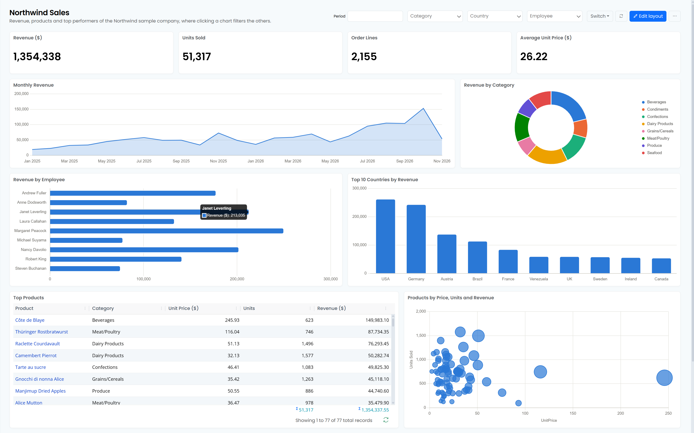
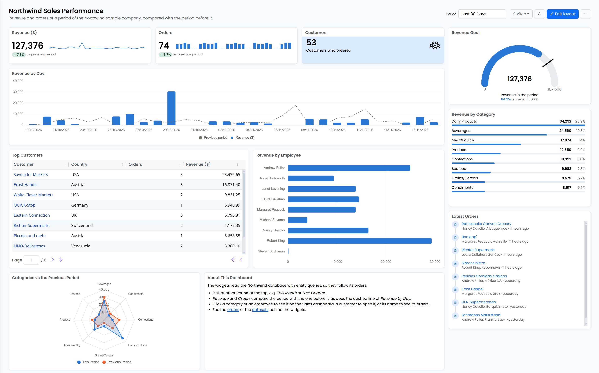
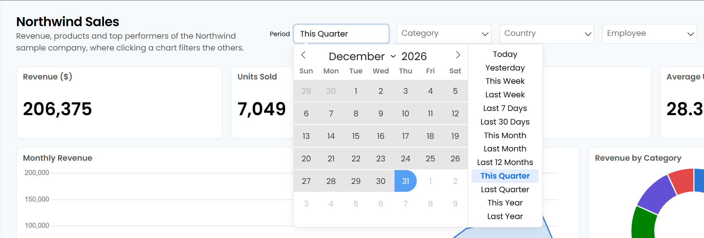
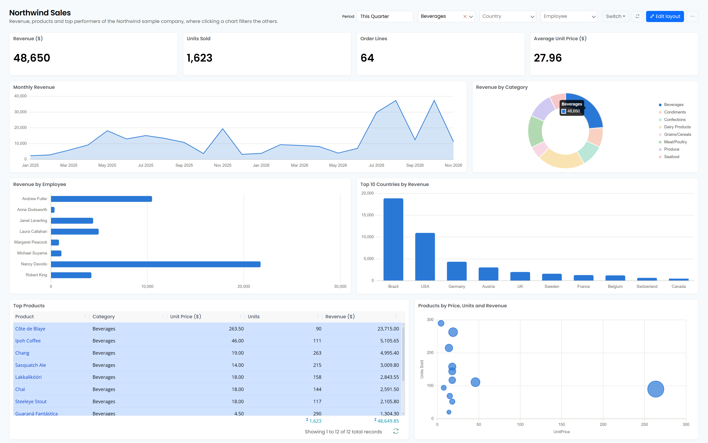
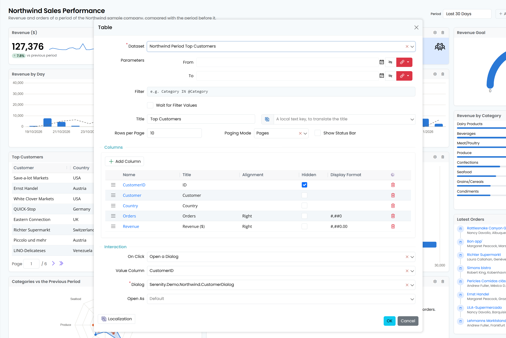
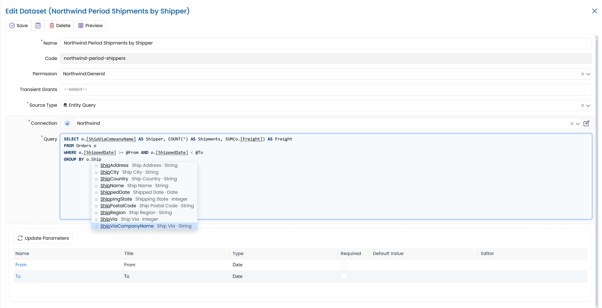
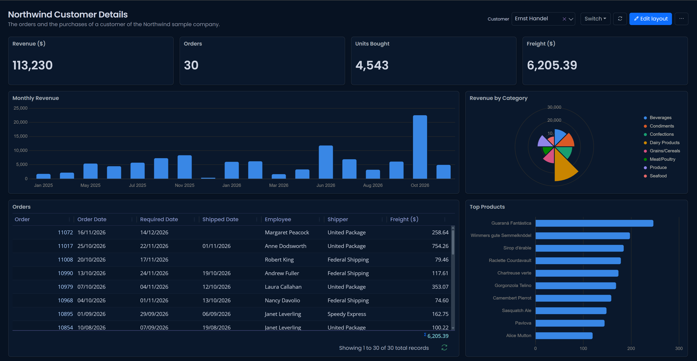

# Introducing Dashboards — Live, Secure Dashboards Built Right Inside Your StartSharp Application

Every business application eventually gets the same request: *"Can we see this on a dashboard?"*

Sales managers want this month's revenue next to last month's. Operations teams want to see the orders that are late to ship. Executives want a single screen that tells them whether things are going well. Until now, a StartSharp team had two ways to answer: write another hand-coded dashboard page, or export the data to a separate BI tool and maintain a second system next to the application.

With this release, **StartSharp Enterprise** gets a third, much better option: **Dashboards**, a dynamic dashboard designer that runs inside your application, plus **DataSources**, the secure data layer underneath it.

## What Is It?

**Dashboards** lets authorized users design interactive dashboards in the browser. They pick widgets, place and resize them on a grid, connect each one to a dataset, add filters, and save, all without writing code or redeploying the application.

**DataSources** is the layer that feeds them. It defines *connections* and *datasets* (named, reusable queries over your data) and runs them safely, with the permissions of the person viewing the dashboard.

The two are separate on purpose. Datasets are written once, secured once and reused by any number of widgets and dashboards. DataSources is also designed to serve as the foundation for future features such as reports and exports.

## Static vs. Dynamic Dashboards

Most StartSharp applications already have a dashboard page: a Razor view with a few cards and charts, coded by a developer. That works, but every change is a development task:

| | Static (hand-coded) dashboard | Dynamic dashboard |
|---|---|---|
| Who changes it | A developer | Anyone with design permission |
| A new chart or KPI | Code, review, build, deploy | A few clicks, saved instantly |
| Different dashboards per team or role | One page, or more code | As many as you need, each with its own permission |
| Filters, drill-down, links between dashboards | Hand-written per page | Built in, configured per widget |
| Moving between test and production | Part of the code | Each item has a code, so dashboards and datasets can be copied between servers |
| Translations | Resource files | Stored with the dashboard, edited in place |

Dashboards doesn't replace your developers. It frees them from an endless queue of "one more chart" requests, so they can focus on the application itself. When something really needs code, such as a custom widget type, the module is fully extensible.

## Why Integrated Beats Bolted-On

There are many BI tools on the market, and some of them are excellent. However, a separate BI product brings its own costs: another login, another permission model to keep in sync, per-seat licensing, data copied out of your database, and dashboards that can't open the screens your users work with every day.

Dashboards is **part of your application**, and it shows:

- **Same users, same sign-in, same permissions.** There is no second user list. A dashboard is visible to the users who hold its permission, and a dataset returns data only to users who are allowed to read it.
- **Your data stays where it is.** Queries run live against your own databases, on your own servers. Nothing is synchronized or copied to a third-party cloud.
- **Click through to real screens.** A click on a product in a chart can open the familiar *Product* dialog. A row in an orders table can open the *Order* dialog, where the user can act on it right away. Dashboards are a starting point for work, not a dead end.
- **Reuse your business logic.** Datasets can read your **entities** and **list services** directly, so the rules you already wrote in your rows and handlers keep applying.
- **Fits in naturally.** Dashboards appear in the application menu, follow your theme (including dark mode), support localization, and any dashboard can become the **home page**, for everyone, for certain roles or for certain users. Users can also choose their own default.

## Features at a Glance

### A Rich Set of Widgets

- **Charts**: line, area, bar (stacked or horizontal), pie, doughnut, polar area, radar, scatter and bubble, with multiple series, target lines and a *compare with previous period* option.
- **Number cards**: KPIs with icons, colors, captions, "more" links and a **trend** against the previous period, shown as a line or bars. For values such as costs, a "lower is better" option makes a drop count as good news.
- **Gauges**: progress toward a target.
- **Tables**: full-featured grids with sorting, grouping, summaries, column formatters, pinned columns and links on any column.
- **Lists** and **funnels**: ranked and staged data at a glance.
- **Activity feeds**: the latest events, with icons, dates and links.
- **Text** (Markdown) and **Links** widgets: explanations, instructions and shortcuts.

Charts and numbers can **aggregate in the database** (sum, count, average, minimum, maximum), group dates by hour, day, week, month, quarter or year, and keep only the top groups. Totals are always computed from all the data, not just the rows that were loaded.

### Interactive Filters

Each dashboard can define its own filters, shown in its toolbar:

- **Date ranges** with presets such as *Last 30 Days* or *This Quarter*, which always follow today's date.
- **Lookups** over any dataset, for example categories, countries, employees or customers.
- Any other editor your application provides.

Each widget decides how a filter applies to it with a simple expression such as `OrderDate >= @Period.Start AND Category IN @Category`. A clause whose filter is empty is simply skipped, so the same widget works with or without a selection. A detail widget can also wait until the user picks a value, for example a customer, and ask for it instead of loading everything.

Filter values are kept in the URL (`?f.Category=Beverages`), so a filtered view can be bookmarked or shared with a colleague.

### Click to Explore

Every chart, list, funnel and table can react to a click:

- **Set a filter**: click a bar in *Sales by Category*, and the whole dashboard narrows down to that category. The selection is highlighted, and clicking it again clears it.
- **Open a link**: go to another dashboard with the clicked value as its filter, for example from a top customer to the *Customer Details* dashboard.
- **Open a dialog**: open the entity dialog of the clicked row directly.

### Designed in the Browser

- Drag-and-drop layout on a responsive grid, with widgets that can be resized freely.
- Widget options in a dialog with sensible defaults, applied to the dashboard as soon as the dialog is saved.
- Table columns configured right from the grid header: hide, pin, sort, group, add or remove.
- A SQL editor with syntax highlighting and context-aware completion of entities, columns, joins and parameters.
- Save conflict detection, so two designers can't overwrite each other's changes by accident.
- Duplicate a dashboard as a starting point, or start from scratch.

### Flexible Data Sources

A dataset can read from:

- **Entities**: your Serenity rows, through their list handlers, with the permissions and behaviors you already defined.
- **Entity queries**: SQL-like queries over entities, with joins that follow foreign keys automatically (`LEFT JOIN o.CustomerID c`).
- **Tables and views** of any configured database connection, with an optional filter.
- **SQL queries**: a familiar SQL syntax, which is parsed, checked and rewritten for the target database. The same query works on SQL Server, PostgreSQL, MySQL, SQLite, Oracle and Firebird.
- **List services**: any of your existing `List` endpoints, executed in-process through the full ASP.NET Core pipeline.
- **JSON**: static data for samples and small lookup lists.

Datasets can declare **parameters** with types, defaults and editors. Each widget can bind a parameter to a fixed value or a dashboard filter, or show it as an editor on the widget itself. A dataset's preview shows its results right in the designer.

## Security, Designed In from Day One

A dashboard system that runs queries against your production database has to be secure by default. That was our first design requirement, not an afterthought.

- **Off until you turn it on.** Table and SQL access is disabled for every connection until an administrator enables it in configuration and decides who may author datasets.
- **No raw SQL ever reaches your database.** Every query is parsed into a syntax tree, validated and written out again by the server. Only `SELECT` statements are possible, and every value is sent as a bound parameter, never concatenated into the SQL text.
- **Access rules per connection.** Administrators decide with `Allow`, `Deny` and `Protect` rules which tables and columns can be used, and which permission each one requires. `Deny` always wins.
- **Sensitive data is protected out of the box.** User tables, password hashes, tokens and similar columns are excluded by default. Wildcards never reach them, so only an explicit, intentional rule can expose them.
- **Row-level filters.** A rule can limit the rows of a table for everyone, for example to the current user's records with `CURRENT_USER_ID`, and the filter applies wherever that table is used, including inside joins.
- **Viewers see only what they may see.** Datasets run with the **viewer's** permissions, not the designer's. Each dataset has its own permission, entity sources keep their row and field permissions, and list services run with full authorization checks. A column the viewer can't read simply isn't there.
- **Controlled privilege grants.** When a dataset must show summary data its viewers can't read directly, an authorized designer can attach a *transient grant*. It is limited to that dataset and to permissions the designer already holds.
- **Guard rails.** Per-connection command timeouts and row limits keep a careless query from hurting the database. Filter expressions sent from the browser can't contain subqueries or functions, so they can't be used to probe other tables.

## Try It in the Demo

The StartSharp demo comes with four sample dashboards built on the Northwind database, which together show most of the features:

- **Northwind Sales**: revenue trends, sales by category, employee and country, top products, and filters that the charts themselves can set.
- **Sales Performance**: KPIs with trends against the previous period, a category comparison radar, top customers and employee rankings.
- **Operations**: shipping performance, orders waiting to ship, freight by shipper.
- **Customer Details**: everything about a single customer, reachable with one click from any other dashboard.

## What's Next

This is the first release, and we have many plans for Dashboards. Some of the items on our roadmap:

- **Dashboards inside entity dialogs**: for example, a *Customer Details* tab in the Customer dialog, filtered automatically by the customer being edited.
- **Dashboard links from any screen**: buttons and menus that open a dashboard with the right filters already applied.
- **Export**: Excel/CSV of the full filtered data, chart images and print-friendly layouts.
- **Scheduled reports and alerts**: dashboards and datasets delivered by e-mail, always with the recipient's own permissions.
- **A widget catalog**: designed widgets that can be reused across dashboards.
- **Auto-refresh**, full-screen mode and result caching for wall displays.
- **Import/export packages** of dashboards and datasets, with version history.
- **More widgets**: pivot tables, conditional formatting, heat maps and more.
- **A visual query builder**, for building aggregations over entities without writing SQL.

Your feedback will shape this list, so please tell us what you would like to see first.

## Get Dashboards

Dashboards and DataSources are included in **StartSharp Enterprise** as of this release.

- **Already an Enterprise customer?** Update to the latest version, and the demo dashboards will be waiting for you.
- **On another StartSharp edition?** Upgrade to Enterprise to give your users live, secure, self-service dashboards inside the application they already use.
- **New to StartSharp?** Visit [serenity.is](https://serenity.is) to learn more about StartSharp and its editions.

Stop building dashboards one page at a time. Let your users build the dashboards they need, safely, right where their data and their work already are.
